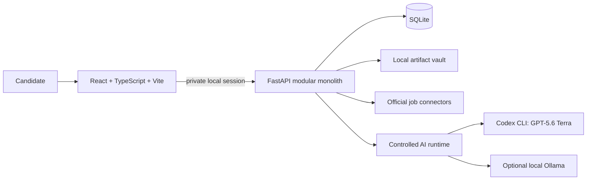

# Carivyo Demo Guide

## The product

Carivyo is a local-first career workspace. A candidate submits a resume, confirms a compact
profile through a short adaptive interview, receives fresh verified job matches, and creates a
job-specific resume only after explicit approval. It does not apply to jobs automatically.

The core design principle is **evidence before AI**: verified resume evidence, job links,
eligibility, matching, and ATS checks are deterministic. AI is used only for bounded synthesis,
conversation, and review through a controlled provider adapter.

## Architecture



Everything except an opted-in provider inference request stays on the local machine: SQLite state,
profile evidence, imported resumes, generated PDFs, and logs. The app binds to loopback only and
uses a private bootstrap/session token for its local browser session.

## Technology map

| Layer | Technology | Responsibility |
|---|---|---|
| Web UI | React 19, TypeScript, Vite | Resume onboarding, jobs, chat, applications, profile settings |
| API | Python 3.11+, FastAPI, Pydantic | Typed local API, validation, security, workflow orchestration |
| State | SQLite | Profiles, preferences, jobs, conversations, audit records, resumable workflow state |
| Files | Local artifact vault | Imported resumes, generated PDFs, previews, reports, backups |
| AI | Codex CLI with GPT-5.6 Terra | Selected demo runtime for bounded AI chat and review |
| Local AI | Ollama | Optional fully-local AI mode; never removed or silently substituted |
| Job data | Official ATS connectors | Greenhouse, Lever, Ashby, SmartRecruiters, Salesforce, Goldman Sachs Higher |
| Document quality | Poppler, pypdf, ReportLab/Tectonic | Extraction consensus, rendering, and ATS-safe resume artifacts |
| Testing | Pytest, Vitest, Playwright | Backend, UI, connector, and browser-flow checks |

## AI runtime modes

| Mode | What runs locally | What leaves the machine |
|---|---|---|
| Codex demo mode | Carivyo records, compact context assembly, validation, SQLite, artifacts | The bounded prompt sent through the authenticated Codex CLI |
| Fully local Ollama | Records and model inference | Nothing for AI inference |
| AI disabled | Deterministic import, search, matching, ATS, and tracking | Nothing |

`./run-demo.sh` selects **Codex CLI + GPT-5.6 Terra**. It does not remove Ollama. In Profile,
the user may select an installed Ollama model and enable **Fully local** when local-only inference
is required.

## End-to-end demo

### 1. Start from a clean workspace

Stop Carivyo, then run:

```bash
./reset-demo-data.sh
./run-demo.sh
```

The reset clears generated profile, job, chat, resume, report, and backup data. It preserves the
local Codex CLI installation in `.carivyo/tools/`.

### 2. Submit a resume

Open `http://127.0.0.1:5173/` and upload a PDF, DOCX, TeX, Markdown, or text resume. Explain that
Carivyo stores the source locally, extracts it through independent paths, and does not claim facts
that cannot be grounded in the imported evidence.

### 3. Complete the adaptive interview

Answer the short questions about role direction, location, work mode, experience tolerance, and
non-negotiables. Emphasize that Carivyo asks only high-impact unresolved questions instead of
forcing a long form.

### 4. Inspect verified jobs

Show the ranked jobs and their official source links. Explain that eligibility gates run before
ranking: an attractive score cannot override an explicit exclusion, incompatible location, senior
scope, or missing official application link.

### 5. Show controlled AI

Open chat and point out **Codex CLI / GPT-5.6 Terra** in the AI runtime settings. Ask for a job
explanation or a profile summary. The server passes compact, bounded context to Codex; it does not
give AI unrestricted shell or browser tools.

### 6. Create a resume only for a selected job

Select a job and start Resume Studio. The run freezes the job snapshot and approved evidence,
creates an ATS-safe artifact, and requires explicit user approval before application handoff.

### 7. Close with control and privacy

Show the application tracker, local export/backup controls, AI-runtime selector, and the API docs
at `http://127.0.0.1:8420/api/docs`.

## Technical answers to expect

**Why not let AI do everything?**
Job facts, eligibility, and candidate claims need auditable evidence. Deterministic rules produce
repeatable decisions; AI adds concise explanation and review inside those boundaries.

**Why SQLite instead of a cloud database?**
Carivyo is a single-user, local-first product. SQLite provides transactional state with no server
setup and keeps personal job-search records on the candidate's machine.

**How is Codex controlled?**
Carivyo invokes the authenticated CLI with the reviewed model catalog, a read-only sandbox,
disabled shell/browser/computer tools, a token budget, and a timeout. It stores only compact local
session metadata and redacts runtime failures.

**Why keep Ollama?**
Ollama gives users a fully local model option. It is a deliberate privacy mode, not a fallback that
silently changes the provider.

**How does a resume stay evidence-safe?**
The run uses frozen approved evidence and a frozen job description. It validates extracted text,
the generated PDF, rendered pages, and ATS checks before approval; unsupported claims are blocked.