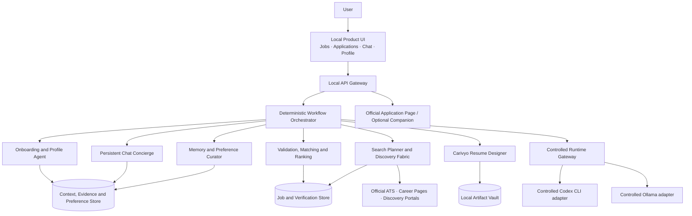

# Carivyo — End-to-End Product and System Architecture

## 1. Executive Design

Carivyo is a single-user, local-first web application that can use an AI runtime already available on the user's computer. The current controlled MVP adapters are Codex and Ollama. The runtime boundary is extensible, but detected Claude Code, Gemini CLI, OpenCode, and other providers are not advertised as usable until a constrained adapter has been implemented and tested.

It has two primary capabilities:

1. **Fresh Job Search:** continuously search, verify, deduplicate, and rank jobs from many sources, prioritizing opportunities posted within 24 hours.
2. **Resume Design on Demand:** create or tailor a resume only after the user selects a job and explicitly starts the workflow.

Onboarding, chat, and preference learning support these two capabilities. They should not become separate configuration-heavy products.

## 2. Product Experience

### First Launch

The ideal first-run sequence is:

1. Carivyo detects installed AI runtimes and authenticated CLIs.
2. The user drops one or more resumes into a single upload surface.
3. The system extracts and organizes the user's career evidence automatically.
4. The UI shows a short “This is how I understand you” summary.
5. An onboarding agent asks only unresolved, high-impact questions one at a time.
6. The user confirms the result in natural language.
7. Carivyo compiles the profile and immediately starts the first job search.

The user should not face a page containing dozens of role, skill, location, salary, and seniority fields.

### Daily Use

The default home screen is **Fresh for you**, showing:

- Verified under 24 hours.
- Verified under 48 hours.
- Live, date unverified.
- Saved jobs.

Each job card has two primary actions:

- **Apply** — revalidate and open the official application.
- **Design resume** — start the separate resume workflow.

A global chat drawer remains available on every screen for commands, explanations, and preference changes.

## 3. High-Level Architecture



The orchestrator owns state, retries, validation, and security. AI agents make bounded decisions through typed contracts; they do not run uncontrolled loops.

## 4. Recommended Technology Stack

### Local Application

- React + TypeScript + Vite for the web UI.
- FastAPI + Pydantic for the local API and structured agent contracts.
- SQLite in WAL mode for transactional state and queues.
- Deterministic token/lexical retrieval in the current MVP, with SQLite FTS5
  as the next indexing optimization.
- `sqlite-vec` or a replaceable local vector adapter as a future optional
  retrieval layer; it is not required for the current ranking path.
- Local filesystem artifact vault for resumes, PDFs, renders, snapshots, and reports.
- Server-Sent Events for streaming search, chat, and resume-run progress.
- Playwright only for permitted browser flows and connector diagnostics.

### Packaging

- Carivyo remains a responsive website. `make dev` binds the backend and web UI
  to fixed loopback ports and opens `http://127.0.0.1:5173/` in the user's normal
  browser. The bootstrap secret is compiled into that development session and
  exchanged once for the in-memory local API session; it is not placed in the
  visible URL. Startup refuses occupied ports, and shutdown terminates the full
  backend and frontend process trees so a stale bundle cannot survive a restart.
- A future packaging helper may install and update the local website services,
  but it must not replace the browser product with a native, desktop, or mobile
  application shell.

The single-user version does not require Redis, Kubernetes, a hosted account service, or a cloud database.

## 5. Zero-Configuration Onboarding

### 5.1 Runtime Detection

At startup, `RuntimeDiscovery` probes known runtimes. Capability reporting is
truthful: detection does not imply that execution is enabled.

```text
Controlled now: Codex, Ollama
Detected but disabled until an adapter exists: Claude Code, Gemini CLI, OpenCode
Future adapter boundary: llama.cpp, LM Studio, compatible local endpoints
```

Each adapter implements:

```text
probe() -> availability and authentication status
capabilities() -> sessions, tools, structured output, usage reporting, cache reporting
start_session(spec) -> session handle
resume_session(handle, spec) -> result
cancel(handle) -> status
```

If several controlled runtimes are available, Carivyo prefers an installed
on-device Ollama model for a fresh profile; explicit user selection still wins.
Ollama cloud pointers are excluded from every local capability. If no local or
controlled provider runtime is available, deterministic onboarding, search,
matching, resume validation, and application tracking still work; open-ended
chat reports degraded mode.

### 5.2 Resume Import

The user uploads PDF, DOCX, TeX, Markdown, or plain text. The import pipeline:

1. Hashes and stores the original artifact.
2. Extracts PDF text locally with Poppler before the pypdf fallback and merges wrapped bullet lines.
3. Detects identity, summary, experience, education, projects, skills,
   achievements, certifications, volunteer work, leadership, publications,
   languages, links, dates, and possible resume tracks.
4. Splits statements into candidate evidence claims.
5. Records source location and confidence.
6. Detects conflicts across multiple resumes.
7. Builds compact track fingerprints such as Backend, AI/LLM, ML, Product, Security, or General.

Exact resume statements are accepted as imported evidence, but uncertain inference is not silently promoted to fact.

### 5.3 Adaptive Interview

`OnboardingAgent` ranks uncertainties by expected impact on search quality. It asks one conversational question at a time and stops when the remaining uncertainty is low enough.

Typical topics:

- Preferred and acceptable locations.
- Remote, hybrid, or onsite openness.
- Work authorization and relocation.
- Desired role direction when several resume tracks are equally strong.
- Experience/seniority tolerance.
- Strong exclusions or non-negotiables.

Rules:

- Infer before asking.
- Ask a maximum of seven questions for normal onboarding.
- Combine related questions when the answer can be natural language.
- Skip salary unless it materially affects search or the user mentions it.
- Let the user say “decide for me.”
- Show the interpreted answer and allow correction.

### 5.4 Context Compilation

After confirmation, `ContextCompiler` creates immutable, versioned artifacts:

```text
profile.json                 full structured profile
profile-capsule.md           compact career summary
evidence-index.jsonl         approved claims and provenance
resume-tracks.json           base-resume fingerprints
preferences.json             hard and soft preferences
search-plan.json             roles, locations, sources and query packs
context-version.json         hashes and versions
```

The full raw resumes are not injected into every AI request.

## 6. Context, Memory, and Preference Architecture

### 6.1 Context Layers

| Layer | Purpose | Update Policy |
|---|---|---|
| Source Artifacts | Original resumes and imported documents | Only on import or replacement |
| Evidence Ledger | Approved candidate facts with provenance | On confirmation or evidence changes |
| Profile Snapshot | Structured career identity and resume tracks | On material evidence changes |
| Preference Snapshot | Hard constraints and soft preferences | On confirmed changes or consolidation |
| Search Plan | Role, location, company, and source strategy | When profile/preferences materially change or plan expires |
| Conversation Memory | Raw messages, rolling summaries, important facts | Incrementally |
| Activity Events | Keep, hide, apply, interview, reject, offer | Every event, without immediate AI processing |

### 6.2 Hard and Soft Preferences

Hard constraints include explicit work authorization, excluded locations, required employment type, and user-confirmed non-negotiables.

Soft preferences include role emphasis, company type, stack interest, seniority stretch, location ranking, and patterns inferred from behavior.

Every learned preference stores:

```text
value
kind: hard | soft | negative
source: explicit | conversation | activity-pattern
confidence
supporting event IDs
created_at
last_confirmed_at
```

AI may propose a preference change, but it cannot silently convert a behavioral pattern into a hard constraint.

Only claim IDs and resume bases named by the active profile snapshot are
eligible for current matching or new resume runs. Re-onboarding inactivates the
previous profile snapshot; globally retained historical artifacts never become
ambient candidate evidence for the new profile.

### 6.3 Memory Consolidation

The system logs every activity cheaply, but runs the memory curator only when:

- The user explicitly states a preference.
- A resume or profile artifact changes.
- Several consistent actions form a pattern.
- A search result receives a meaningful reason.
- A scheduled consolidation window is reached.

Example:

```text
Three frontend-heavy roles hidden with similar reasons
-> propose "Prefer backend-heavy roles"
-> store as a medium-confidence soft preference
-> optionally ask for confirmation
```

This avoids spending tokens after every click.

## 7. Agentic System Design

Carivyo uses specialized agents inside deterministic state machines.

| Agent | Responsibility | AI Use |
|---|---|---|
| Onboarding Agent | Understand imports and ask minimal questions | High during setup |
| Profile Compiler | Convert evidence into reusable structured context | Only after material changes |
| Search Planner | Build role families, query packs, source priorities, and location budgets | Once per plan version |
| Connector Workers | Fetch source data | No LLM |
| Validation Engine | Confirm official URLs, live status, dates, eligibility, and source semantics | Deterministic |
| Matching Engine | Hard filters, lexical/semantic scoring, evidence mapping | Mostly deterministic/local |
| Match Analyst | Rerank the shortlist and produce concise explanations | Batched AI |
| Chat Concierge | Route commands, explain results, and edit preferences | Per user message |
| Resume Designer | Run the separate `carivyo-resume-designer` skill | Only on explicit request |
| Memory Curator | Summarize history and propose preference changes | Event-triggered |

Each AI step receives:

- A narrow objective.
- A typed input.
- An allowlisted tool set.
- A token and time budget.
- A required structured output schema.
- Evidence and uncertainty rules.

The orchestrator rejects malformed or unsupported results rather than trying to interpret them as truth.

## 8. Controlled CLI and Local-Model Runtime

### 8.1 Runtime Gateway

The website never sends raw shell commands. It sends a structured `AgentRunSpec`:

```json
{
  "agent": "chat-concierge",
  "provider": "codex-cli",
  "session_id": "uuid",
  "workspace": "allowed-absolute-path",
  "context_version": "sha256",
  "inputs": {},
  "allowed_tools": ["read-context", "query-jobs", "update-soft-preference"],
  "network_policy": "none|job-sources|provider",
  "input_token_budget": 6000,
  "output_token_budget": 900,
  "timeout_seconds": 120,
  "output_schema": "ChatResult"
}
```

The process broker:

- Invokes executables with argument arrays, never interpolated shell strings.
- Uses a dedicated working directory per conversation or workflow.
- Provides only required environment variables.
- Restricts readable and writable paths.
- Enforces concurrency, memory, time, and output limits.
- Streams structured events to the UI.
- Redacts secrets and personal data from logs.
- Records provider, model, CLI version, prompt hash, context hash, and usage.

### 8.2 Session Strategy

Maintain separate provider sessions for:

- Main chat.
- Each search analysis run.
- Each resume-design run.

Provider sessions improve continuity, but Carivyo remains the source of truth. If a CLI session disappears or changes format, the app reconstructs the required compact context from local memory.

Resume runs are stricter than chat sessions: the initial run freezes the job
description, profile snapshot, approved evidence package, selected base,
instructions, and hashes inside the run workspace. A focused revision reloads
that package only; it never reads the currently active profile or broader
artifact vault.

## 9. Persistent Chat and Token Optimization

### 9.1 Important Constraint

A long-lived terminal session does not guarantee token savings. Some providers resend the full history, some summarize internally, and some expose prompt-cache discounts. Carivyo must therefore optimize context independently of provider behavior.

### 9.2 Conversation Storage

Store:

- Raw local message history.
- Latest conversational turns.
- A rolling episodic summary.
- Important durable memory facts.
- References to jobs, searches, applications, and resume runs.
- Provider session handles when available.

The raw history is available for audit and search but is not replayed on every message.

### 9.3 Context Assembly

For each chat request, `ContextAssembler` builds:

```text
stable system and tool prefix
compact profile capsule
current preference capsule
relevant memory retrieved by lexical/vector search
latest 6-10 conversation turns
current page and selected entities
task-specific job, application, or resume data
```

Older conversation is represented by a rolling summary. Full artifacts are loaded only when the task requires them.

### 9.4 Prompt Caching

Keep the stable prefix byte-identical and place it before changing context so provider-native prompt caching can apply when supported. Record:

- Input tokens.
- Output tokens.
- Cache-write tokens.
- Cache-read tokens.
- Estimated or actual cost.
- Local-model generation tokens and latency.

If the CLI does not expose usage, estimate with a provider-compatible tokenizer and label the value **estimated**.

### 9.5 Typical Token Budgets

These are design targets, not provider guarantees:

| Operation | Typical AI Input | Typical AI Output | Frequency |
|---|---:|---:|---|
| Initial profile extraction | 8k–25k | 1k–3k | Once per imported profile version |
| One onboarding answer | 1.5k–4k | 100–400 | Three to seven times |
| Search-plan generation | 2k–6k | 800–2k | Only after material preference/profile changes |
| Broad job discovery and validation | 0 | 0 | Frequent, code-driven |
| Batch rerank of top jobs | 6k–18k per run | 1k–3k | One to three batches per search |
| Explain one job | 1.5k–4k | 200–600 | On demand or cached |
| Normal chat command | 2.5k–7k | 200–900 | Per message |
| Resume design | 8k–25k | 2k–6k | Only for selected jobs |
| Resume revision | 3k–8k | 500–2k | Only after feedback |
| Memory consolidation | 2k–6k | 300–900 | Event-triggered |

### 9.6 Token-Saving Rules

- Never use an LLM to crawl, deduplicate, check HTTP status, parse known ATS JSON, or sort records.
- Use local embeddings and deterministic scoring before AI reranking.
- Batch top candidates instead of calling the model once per job.
- Cache normalized JDs, skill extraction, company facts, explanations, and resume analyses by content hash.
- Regenerate a search plan only when its dependent context version changes.
- Use structured deltas for profile and preference updates.
- Summarize old chat turns and retrieve only relevant memories.
- Generate one resume candidate and patch it instead of repeatedly rewriting the whole document.
- Enforce daily and per-workflow budgets with graceful fallbacks.

### 9.7 Token UI

The Chat diagnostics panel should show:

- Active provider and model.
- Context size for the current request.
- Measured or estimated input/output tokens.
- Cache hit/read information when exposed.
- Daily and monthly totals by agent.
- The largest context contributors.
- A privacy indicator showing local versus remote processing.

Normal users see a simple usage indicator; detailed accounting remains behind **AI usage**.

## 10. High-Coverage Job Search Architecture

### 10.1 Search Plan

`SearchPlanner` compiles the profile and preferences into:

```text
target role families and aliases
strong and transferable skills
experience and seniority bands
preferred location sequence
remote and relocation rules
company and industry interests
negative keywords and exclusions
ATS/source priorities
freshness windows
query packs and search budgets
```

The plan is versioned and reused until a material dependency changes.

### 10.2 Scalable Source Fabric

Carivyo should support unbounded source expansion through connectors, not promise a permanently complete list.

Connector layers in the long-term architecture:

1. Official ATS adapters: Greenhouse, Lever, Ashby, Workable, SmartRecruiters, Workday, iCIMS, Jobvite, Recruitee, Teamtailor, and similar systems.
2. Official company career-page adapters.
3. Discovery connectors: search engines, job boards, startup directories, fresher boards, and sector directories.
4. Browser-session connectors for user-authorized signed-in sources.
5. Manual URL/JD import.
6. Community or organization source packs through a connector SDK.

An ATS fingerprint detector examines URLs and page metadata, identifies the underlying platform, and routes the job to the correct official adapter.

Every connector implements:

```text
discover(search_slice, cursor) -> RawJobRef[]
fetch(raw_ref) -> RawSnapshot
normalize(snapshot) -> JobCandidate
verify(candidate) -> VerificationResult
healthcheck() -> ConnectorHealth
```

The implemented boundary is Greenhouse, Lever, Ashby, and SmartRecruiters with
a curated official source catalog. SmartRecruiters pagination is complete at
the summary layer and detail verification is bounded; any unverified remainder
is explicitly partial. The remaining layers are extension points, not claims
of completed coverage.

### 10.3 Search Coverage Loop

Each search run executes coverage slices:

1. Preferred-location queries for every role family.
2. Official ATS index sweep.
3. Curated company and sector sweep.
4. Discovery-board sweep.
5. Company second-hop expansion from newly discovered roles.
6. Gap analysis for role/location/source combinations with weak coverage.
7. Targeted follow-up slices until the time/source budget is exhausted.

Search progress records the role, location, source, query, result count, rejection count, and failure reason. This prevents the system from claiming broad coverage without evidence.

### 10.4 Efficient Processing Pipeline

```mermaid
flowchart LR
    PLAN["Versioned Search Plan"] --> FETCH["Parallel Connector Fetch"]
    FETCH --> NORMALIZE["Normalize and Fingerprint"]
    NORMALIZE --> DEDUPE["Deduplicate"]
    DEDUPE --> VERIFY["Live and Freshness Verification"]
    VERIFY --> GATE["Hard Eligibility Gates"]
    GATE --> CHEAP["Lexical + Local Embedding Score"]
    CHEAP --> SHORT["Top Candidate Pool"]
    SHORT --> RERANK["Batched AI Rerank"]
    RERANK --> FEED["Location-Aware Job Feed"]
```



Broad discovery should consume network and CPU, not LLM tokens.

### 10.5 Freshness Model

Use explicit freshness classes:

| Class | Requirement |
|---|---|
| Verified ≤24h | Live official route plus trustworthy posting evidence inside 24 hours |
| Verified ≤48h | Same, inside 48 hours |
| Recent/live, date unverified | Official route is live but the posting time cannot be proven |
| Older but live | Posting is older, still open, and remains a strong fit |
| Uncertain | Live status, date semantics, or eligibility could not be confirmed |
| Closed | Official route is unavailable or explicitly closed |

Search snippets may help discovery but cannot independently prove live status. An `updated_at` value is not a posting date unless the source documents that meaning.

Defaults:

- Run lightweight source scans every two to four hours while the app is active.
- Create a full daily coverage run.
- Revalidate visible jobs every 12 hours.
- Revalidate immediately before **Apply** or **Design resume**.
- Cache unchanged HTTP responses with ETag/Last-Modified support.

## 11. Matching, Recommendation, Location, and Sorting

### 11.1 Hard Gates

Reject or isolate:

- Closed or unverifiable application routes.
- Ineligible country, work authorization, or remote region.
- Explicit user exclusions.
- Clearly incompatible employment types.
- Clearly senior/irrelevant roles beyond configured tolerance.

### 11.2 Baseline Score

Use an explainable deterministic baseline:

| Factor | Weight |
|---|---:|
| Responsibility and role-family fit | 25 |
| Evidence-backed skill fit | 22 |
| Experience and seniority fit | 13 |
| Location and work-mode fit | 15 |
| Freshness and verification quality | 15 |
| Company and learned preference fit | 10 |

Local semantic similarity improves recall. A batch AI reranker may adjust shortlisted results inside a bounded range and must return reason codes linked to JD spans and evidence IDs.

AI cannot override a hard eligibility failure or manufacture missing evidence.

### 11.3 Default Feed Ordering

The default feed is grouped by the user's location preference order. Within each location:

1. Recommendation tier.
2. Fit score descending.
3. Freshness class.
4. Verified posting time descending.
5. Source confidence.

An **Apply first** strip may rank the strongest jobs across all acceptable locations. When scores are close, the user's location order wins.

The search planner assigns minimum coverage quotas to each preferred location so one high-volume city cannot dominate the entire result set.

### 11.4 Job Card

Show only the decision-critical fields:

- Company and role.
- Location/work mode.
- Freshness badge and verification time.
- Fit score and shortlist tier.
- Up to three evidence-backed reasons.
- Main risk or missing requirement.
- Salary only when posted.
- **Apply**, **Design resume**, **Save**, and **Hide**.

Expanded evidence, full JD, source history, and scoring details remain one click away.

## 12. Resume Design Architecture

### 12.1 Explicit Trigger

Job search may recommend a base resume but must not generate a tailored resume automatically. The workflow begins only when the user selects **Design resume**.

Before starting:

1. Revalidate the job.
2. Freeze the exact JD snapshot.
3. Ask for optional natural-language instructions in one text box.
4. Show the interpreted instructions before generation.

Examples:

- “Keep my current layout and emphasize backend work.”
- “Use the AI resume but include my strongest Java project.”
- “Make it one page and do not change my summary too much.”

### 12.2 Separate General Skill

The repository skill is:

```text
skills/carivyo-resume-designer/
```

It is independent from every person-specific skill or profile.

The skill:

- Uses approved user evidence and base resumes.
- Maps JD requirements to `direct`, `transferable`, `unsupported`, or `unclear`.
- Selects the strongest base.
- Converts custom instructions into structured preferences.
- Plans minimal changes.
- Produces editable source and PDF.
- Runs compile, page, extraction, link, evidence, section-completeness,
  change-budget, and visual checks.
- Runs an advisory, job-specific hiring-manager simulation through an on-device
  Ollama model when one is available. It receives only the frozen evidence and
  cannot control approval. Its visible score is a disclosed 75/25 composite of
  deterministic evidence coverage and local-model judgment.
- Returns structured results for the UI.
- Requires user approval.

### 12.3 Resume Studio UI

Use a focused split view:

- Left: job requirements and evidence mapping.
- Center: rendered resume preview.
- Right: custom instructions, meaningful diff, validation, gaps, and approval.

The user can converse with the resume run without polluting the main chat thread. Revisions are patches against the current variant.

## 13. Application Workflow

When the user chooses **Apply**:

1. Revalidate live status, JD hash, and official URL.
2. Warn if the job changed after resume generation.
3. Confirm the selected approved resume.
4. Prepare evidence-backed answers from the local answer bank.
5. Open the official application.
6. Optionally allow a browser companion to fill approved fields and upload the chosen resume.
7. Require the user to review and submit.
8. Record the application after confirmation.

Carivyo never bypasses login, CAPTCHA, anti-bot controls, or final user review.

## 14. UI and Neomorphic Design System

### 14.1 Product Layout

Use four primary navigation items:

```text
Jobs
Applications
Chat
Profile
```

Add a global natural-language command bar and a contextual chat drawer. Keep advanced source, scoring, and AI settings under progressive disclosure.

### 14.2 Visual Style

Use **soft functional neomorphism**:

- Raised surfaces for cards and primary actions.
- Inset surfaces for search, chat input, and filters.
- Flat high-contrast states for warnings, evidence, freshness, and selected controls.
- Limited shadows in dense job lists to avoid visual noise.

Recommended light palette:

| Token | Value |
|---|---|
| App background | `#E9EEF5` |
| Raised surface | `#F3F6FA` |
| Primary text | `#172033` |
| Secondary text | `#667085` |
| Primary action | `#4F63E7` |
| Accent | `#18A999` |
| Success/fresh | `#2E9D67` |
| Warning | `#D68A1F` |
| Danger/closed | `#D65353` |
| Border/focus | `#8392F5` |

Shadow tokens:

```css
--shadow-raised:
  8px 8px 20px rgba(174, 184, 198, 0.48),
  -8px -8px 20px rgba(255, 255, 255, 0.90);

--shadow-inset:
  inset 4px 4px 10px rgba(174, 184, 198, 0.42),
  inset -4px -4px 10px rgba(255, 255, 255, 0.88);
```

Typography:

- `Inter Variable` for interface and content.
- `JetBrains Mono` for URLs, hashes, logs, and technical diagnostics.
- 15–16px body text.
- 13px metadata.
- 18px card titles.
- 24–30px page titles.
- 1.45–1.6 body line height.

Accessibility:

- Meet WCAG AA contrast.
- Do not use shadow alone to communicate state.
- Provide visible keyboard focus rings.
- Respect reduced-motion settings.
- Use minimum 44px interactive targets.
- Keep badges readable without relying only on color.

## 15. Data Model

| Entity | Important Fields |
|---|---|
| `SourceArtifact` | path, type, hash, extracted text, import time |
| `EvidenceClaim` | text, category, source location, approval, confidence, conflicts |
| `ProfileSnapshot` | structured profile, summary capsule, version, dependent hashes |
| `ResumeBase` | track, source, extracted text, layout, validation, hash |
| `Preference` | value, hard/soft/negative, source, confidence, event IDs |
| `SearchPlan` | profile version, preference version, role/location/source slices, expiry |
| `Connector` | type, source domain, trust tier, rate limit, health, parser version |
| `SearchRun` | plan version, slices, coverage, counts, status, timing |
| `Job` | canonical identity, title, company, JD snapshot, location, first/last seen |
| `JobVerification` | official URL, live state, freshness class, evidence, checked time |
| `MatchResult` | factor scores, evidence IDs, JD spans, risks, explanation version |
| `Conversation` | domain, provider session, context version, rolling summary |
| `Message` | role, content, entity references, token usage |
| `MemoryItem` | fact/preference/episode, source, confidence, embedding |
| `ResumeRun` | job, base, instructions, variants, validation, selected artifact |
| `Application` | job, status, resume, answers, timestamps, outcome |
| `ActivityEvent` | keep/hide/apply/interview/reject/offer, reason, metadata |
| `AgentRun` | agent, provider, context hash, input/output, usage, artifacts, error |

Raw job pages, JDs, and generated documents are immutable content-addressed artifacts. Scores and resumes always reference the exact versions that produced them.

## 16. Local API Surface

Current MVP routes:

```text
GET    /api/runtime/providers
PATCH  /api/runtime/settings
POST   /api/onboarding/import
POST   /api/onboarding/message
POST   /api/onboarding/confirm
GET    /api/profile
POST   /api/profile/resume
GET    /api/preferences
PATCH  /api/preferences
POST   /api/search-runs
GET    /api/search-runs/{id}
GET    /api/runs/{id}/events
GET    /api/jobs
GET    /api/jobs/{id}
POST   /api/jobs/{id}/verify
POST   /api/jobs/{id}/feedback
POST   /api/jobs/{id}/resume-runs
POST   /api/resume-runs/{id}/message
POST   /api/resume-runs/{id}/approve
GET    /api/resume-runs/{id}/ats-analysis
GET    /api/resume-runs/{id}/artifact/{kind}
POST   /api/jobs/{id}/prepare-application
POST   /api/jobs/{id}/open-apply
GET    /api/applications
PATCH  /api/applications/{id}
POST   /api/chat/messages
GET    /api/chat/conversations/{id}
GET    /api/ai-usage
POST   /api/backup
GET    /api/export
DELETE /api/data
```

In-place restore remains a deferred route because replacing a live SQLite
database and artifact vault requires a shutdown/verification/restart protocol.

Every mutating endpoint requires a localhost session token, origin validation, and a typed request schema.

## 17. Security, Privacy, and Hallucination Control

### Local Security

- Bind to `127.0.0.1` by default.
- Use a random startup session secret and strict origin/CSRF checks.
- Keep provider credentials in the operating-system keychain or provider CLI.
- Use strict current-user permissions for the database, artifacts, and runtime workspaces.
- Rely on operating-system account security and full-disk encryption for the
  current MVP; application-managed field encryption and encrypted backups are
  distribution hardening work.
- Restrict file access to imported artifacts and Carivyo workspaces.
- Use argument-safe process spawning and allowlisted tools.
- Provide export, backup, offline mode, and complete deletion.

### Untrusted Content

Job descriptions and web pages are data, not instructions. Sanitize HTML and isolate page text from system/tool prompts. Ignore embedded requests to reveal data, alter policy, run tools, or contact third parties.

### Truth and Evidence Gates

- AI cannot declare a job live or fresh; the validation engine does.
- AI cannot create a candidate fact; it must reference an approved evidence ID.
- Match reasons must reference both JD evidence and candidate evidence.
- Unsupported information is labeled `unsupported`, `unclear`, or `unknown`.
- Structured outputs are schema-validated before persistence.
- Final resume and application actions require user review.

## 18. Performance and Reliability

- Run connectors concurrently with per-domain rate limits.
- Rate-limit local API requests and return explicit retry guidance.
- Use conditional HTTP requests and content hashes.
- Persist cursors and resume interrupted searches.
- Deduplicate before expensive processing.
- Use bounded queues for search, AI, and document work.
- Batch embeddings and AI reranking.
- Cache by job snapshot, profile version, preference version, model, and prompt version.
- Retain raw source snapshots so parser updates can reprocess without another fetch.
- Use bounded exponential backoff and connector circuit breakers.

Diagnostics should report:

- Source health and coverage by role/location.
- Jobs discovered, deduplicated, verified, rejected, and ranked.
- Freshness-evidence coverage and dead-link rate.
- AI provider status, latency, tokens, cache usage, and failures.
- Resume validation and evidence checks.
- Queue state, retry status, and redacted logs.

## 19. Testing Strategy

### Unit

- Resume extraction and evidence provenance.
- Preference confidence and consolidation thresholds.
- Search-plan invalidation.
- URL canonicalization and deduplication.
- Freshness and timezone classification.
- Eligibility gates and sorting.
- Context assembly and token-budget enforcement.
- Unsupported-claim and change-budget detection.
- Runtime path and command isolation.

### Contract

- Saved fixtures for each ATS adapter.
- Connector SDK compatibility.
- Provider runtime adapters.
- Agent input/output schemas.
- Resume skill run contract.

### End-to-End

- Launch → detect CLI → upload resume → adaptive interview → first job feed.
- Search multiple source families and preserve location coverage.
- Reopen chat after restart with compact memory.
- Update a preference from chat and selectively invalidate the search plan.
- Select job → add custom instructions → generate and approve resume.
- Revalidate closed/changed jobs before application.
- Run completely offline except for job-source network access.

## 20. Delivery Plan

### 20.1 Build Baseline and Explicit MVP State Rules

The first implementation is a modular monolith with one FastAPI process, one
React SPA, one SQLite database, and one local artifact vault. Agent names denote
bounded workflow responsibilities, not separately deployed services.

The critical MVP proves this loop:

```text
resume import
-> evidence review and 3-7 adaptive answers
-> versioned profile and search plan
-> Greenhouse + Lever + Ashby + SmartRecruiters search
-> deterministic live/freshness verification
-> explainable matching
-> explicit resume run
-> user-reviewed application handoff
```

The following state rules resolve build-critical ambiguity:

- If no usable AI runtime is available, deterministic onboarding, search,
  ranking, and resume validation remain available. Chat reports degraded mode
  and does not pretend an AI response was produced.
- Conflicting imported claims remain `unclear` until corrected. A user may
  continue with a partial profile only after the unresolved claims are visibly
  excluded from approved evidence.
- A search run is `complete`, `partial`, or `failed`. It may be `complete` with
  zero eligible jobs when official sources succeeded but every result failed a
  hard role, location, work-mode, seniority, source, or 48-hour freshness gate.
  The UI must show rejection evidence and never pad the feed with weaker jobs.
- `Apply` and `Design resume` are enabled only for a currently live official
  route. They revalidate first and enter a blocked or changed-job state when
  validation fails.
- Explicit chat statements create confirmed preference changes and invalidate
  the dependent search plan immediately. Behavioral signals remain soft
  proposals and are consolidated later.
- Long workflows persist stage checkpoints. After restart, interrupted search
  and resume runs are marked recoverable and may resume from their last
  idempotent stage.
- Application tracking in the MVP is manual after the official page opens. The
  system distinguishes `draft`, `opened`, `applied`, `interview`, `rejected`,
  and `offer`; it never infers submission.

Browser-session connectors, automated form filling, in-place restore, advanced
behavioral learning, and broad discovery sources remain extension points rather
than claims of completed MVP functionality.

### Phase 0 — Product Foundation

- Local API/UI shell, secure runtime gateway, SQLite, artifact vault, event streaming.
- Runtime detection for one agent CLI and one local-model endpoint.
- Resume import, evidence ledger, profile compiler, and adaptive onboarding.
- Persistent chat with rolling summaries and token accounting.

### Phase 1 — Excellent Fresh Job Search

- Greenhouse, Lever, Ashby, and SmartRecruiters official-board connectors.
- Search planner, coverage slices, normalization, deduplication, freshness validation.
- Deterministic scoring, local embeddings, batch AI reranking.
- Fresh job inbox with location-aware ordering and direct official apply links.

### Phase 2 — Resume Design on Demand

- Integrate `skills/carivyo-resume-designer`.
- Base-resume selection, custom-instruction interpretation, diff view, validation, and approval.
- Application tracker and copy-ready answer workspace.

### Phase 3 — Coverage and Automation

- Workday, iCIMS, Jobvite, Recruitee, Teamtailor, and browser-session sources.
- Connector/source-pack SDK.
- User-approved application autofill without automatic submission.
- Advanced preference learning, notifications, and analytics.

### Phase 4 — Product Distribution

- Signed installers for the local website services, updates, migrations, and
  diagnostics bundles without introducing a separate native UI.
- Optional encrypted device sync that preserves local ownership.
- Community connector and skill ecosystem.

## 21. MVP Acceptance Criteria

The MVP is ready when a new user can:

1. Launch the site and automatically detect a supported AI runtime.
2. Upload a resume without completing a long form.
3. Finish onboarding in no more than seven adaptive questions.
4. Receive a compiled profile, preference summary, and automatic first search.
5. See verified, deduplicated jobs from four official ATS families while every
   source reports whether its observed coverage was complete or partial.
6. View results grouped by preferred location and sorted by recommendation quality.
7. See freshness evidence, fit reasons, risks, and official apply URLs.
8. Use persistent chat after restarting the application without replaying full history.
9. Inspect measured or estimated token usage.
10. Select a job, give custom resume instructions, and run the separate general resume skill.
11. Review the diff and validation before approving the resume.
12. Complete the core workflow with personal data stored locally and no mandatory cloud AI service.

For this repository, “ready” means the local MVP boundary documented in
`docs/readiness.md`; it does not mean exhaustive source coverage, automatic
submission, encrypted sync, or internet-scale multi-user operation.

## 22. Final Architectural Position

Carivyo should not be built as a large form connected to a chatbot, and it should not use an expensive LLM call for every job or every click.

It should be built as:

- A deterministic local career data platform.
- A scalable, verification-first job discovery engine.
- A small group of bounded AI agents operating over structured context.
- A persistent, compact-memory chat interface.
- A user-triggered, evidence-constrained resume studio.

The product's quality will be determined by recommendation trust, freshness accuracy, ease of setup, resume integrity, and useful work per token—not by the raw number of agents or scraped listings.
